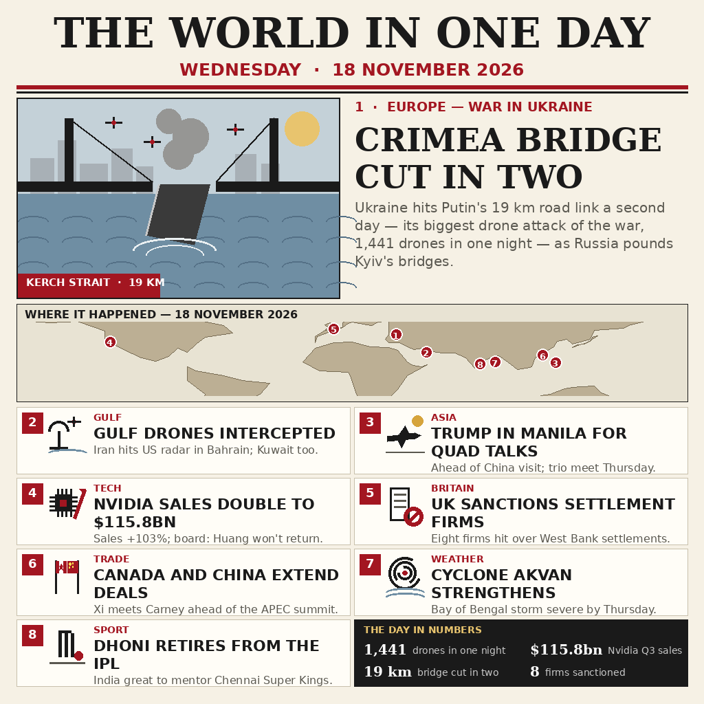

# The World in One Day — 18 November 2026

A front-page newspaper image summing up the world news of Wednesday
18 November 2026, for the make.fun bounty
**"Sum up 18 November's world news in one image"**
(`news-image-20261118`).



## The day, in one image

1. **Europe — Crimea bridge cut in two.** Ukraine hits Putin's 19 km
   road link a second day — its biggest drone attack of the war,
   1,441 drones in one night — as Russia pounds Kyiv's bridges.
   *(Reuters)*
2. **Gulf — Gulf drones intercepted.** Iran hits a US radar at
   Sheikh Isa Air Base, Bahrain; Kuwait's defences engage.
   *(Reuters)*
3. **Asia — Trump in Manila for Quad talks.** Ahead of his China
   visit; Putin, Xi and Trump meet in Shenzhen on Thursday.
   *(Jagran Josh)*
4. **Tech — Nvidia sales double to $115.8bn.** Quarterly sales up
   103% year on year; the board says Jensen Huang will not return
   as CEO. *(CNBC-TV18)*
5. **Britain — UK sanctions settlement firms.** Eight Israeli firms
   hit over West Bank settlements. *(Times of India)*
6. **Trade — Canada and China extend deals.** Xi meets Carney ahead
   of the APEC summit. *(Jagran Josh)*
7. **Weather — Cyclone Akvan strengthens.** The Bay of Bengal storm
   turns severe by Thursday. *(IMD / Jagran Josh)*
8. **Sport — Dhoni retires from the IPL.** The India great becomes
   Chennai Super Kings mentor. *(Times of India)*

Plus a world map of where it happened and a "day in numbers" box
(1,441 drones · $115.8bn · 19 km · 8 firms).

## Files

- `entry.png` — the entry image, 1024×1024, deterministic.
- `gen.py` — the generator (Pillow + DejaVu fonts, run locally).
  Re-run it to regenerate `entry.png` byte-identically.
- `main.py` — stdlib-only entry point: copies `entry.png` to
  `$MAKEFUN_OUTPUT_DIR/entry.png`.

## Reproduce

```sh
python3 gen.py          # regenerates entry.png (deterministic)
MAKEFUN_OUTPUT_DIR=out python3 main.py
```

Two runs of `gen.py` produce byte-identical `entry.png`
(sha256 `8a016c746f7aeff7650d9d16342458ac03925096fcebd5ef9f81c985b7ad3092`).

## License

MIT — see `LICENSE`.
